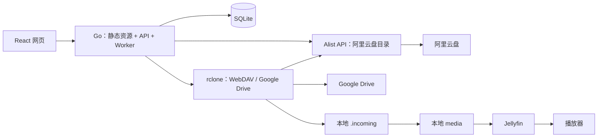

# home-streaming-assistant：开发架构方案

> 状态：**应用与部署代码已实现**（Go 服务、React 前端、Dockerfile、Quadlet 与部署脚本）。镜像构建使用 `scripts/build-image.sh`，交付 deb 使用 `scripts/deploy-deb.sh`。目标是在 Debian 上以一个 OCI/Docker 镜像运行 Go 服务：React 前端构建成静态文件嵌入 Go 可执行文件，由 Go 同一端口提供网页与 API；SQLite 保存下载任务；通过 Alist 接入阿里云盘、通过 rclone 接入 Google Drive；完整文件按需下行到本地后交给 Jellyfin 播放。Google Drive 还支持指定目录的定时**单向下行**，不上传。

## 1. 职责与范围

| 组件 | 来源 | 职责 |
|---|---|---|
| `home-streaming-assistant` | **本项目开发**：Go + React + SQLite | 统一目录、任务、下载、下行计划、本地文件索引和管理页面；在容器内调用 rclone；Go 提供 React 静态页面 |
| Alist（AliyundriveOpen） | 现成中间件/驱动 | 阿里云盘登录与目录 API、WebDAV 文件读取；单独容器，配置只读访问账户 |
| rclone（WebDAV、Google Drive backend） | 现成程序，**打包进应用运行镜像** | 从 Alist WebDAV 或 Google Drive 列出、读取并下载文件，不负责本项目的任务状态与页面 |
| SQLite | 现成嵌入式数据库 | 持久化应用的任务、文件版本及下行设置；不另起数据库容器 |
| Jellyfin | 现成媒体服务，独立容器 | 只读本地完整媒体文件，索引、转码并供电视/手机/网页播放；不负责云盘下载 |
| Docker Engine / Podman | 容器运行环境 | 构建和运行标准 OCI 镜像；在 deb 上采用 Podman + Quadlet 部署，不假定安装 Docker Engine |

本期不做云端直接播放、未下载完即播放、远程挂载/FUSE、云盘上传与删除、影片海报和剧情刮削。**云端目录展示只获取文件元数据；播放必须等文件完整下载并发布。**



Alist API 用于阿里云盘目录分页；下载使用 rclone 的 `aliyun:` WebDAV remote。Google Drive 使用 rclone 的独立 `gdrive-ro:` remote。**浏览器只访问 Go，不直连 Alist、rclone 或 SQLite。**

## 2. 拟建代码结构

```text
home-streaming-assistant/
├── cmd/server/main.go              # HTTP 服务、Worker 和定时器的装配与退出
├── internal/
│   ├── api/                        # 认证、路由、错误响应和静态资源兜底
│   ├── catalog/                    # 两种云端列表适配与统一 Entry 模型
│   ├── downloads/                  # 入队、并发、取消、校验、原子发布
│   ├── schedule/                   # Google Drive 定时目录扫描、逐文件入队
│   ├── storage/                    # SQLite 迁移、任务和本地文件记录
│   └── config/                     # 环境变量、允许的 remote/目录配置
├── web/
│   ├── assets.go                   # package webassets；go:embed dist
│   ├── src/                        # React + TypeScript：目录、详情、任务、设置
│   ├── package.json
│   ├── package-lock.json
│   └── dist/                       # Vite 构建产物，不提交；Go 编译前生成
├── Dockerfile                      # Node → Go → Debian 运行时多阶段构建
├── .dockerignore
└── README.md
```

前端选 React + TypeScript + Vite；Go 使用标准库 `net/http`、`embed` 与纯 Go SQLite 驱动（如 `modernc.org/sqlite`，避免运行镜像依赖 CGO）。建议 `web/assets.go` 定义 `//go:embed dist`，Go 使用 `fs.Sub(..., "dist")` 提供带哈希的 JS/CSS 和 `index.html`。**Vite 必须先生成 `web/dist` 再执行 `go build`**；`/api/*`、`/healthz` 不得落入 SPA 的 `index.html` 兜底，未知 API 返回 JSON 404。`index.html` 禁止长缓存，哈希静态资源可长缓存。开发时 Vite 代理 `/api` 到 Go；生产环境只开放 Go 一个网页/API 端口，无须 Nginx 容器。

## 3. 云端适配与凭证

| 来源 | 列目录 | 下载文件 | 账户与限制 |
|---|---|---|---|
| 阿里云盘 | Go 服务端向 Alist `POST /api/fs/list` 传 `path/page/per_page`，归一化文件名、大小、修改时间、目录类型 | rclone `copyto aliyun:相对路径 /data/files/.incoming/任务ID/文件`；`aliyun:` 是 Alist WebDAV backend | Alist 为应用创建单独账户，仅授予目标路径的读取/Webdav read，不授予 Webdav manage/上传/删除；API 登录 token 只在服务端保存，过期时重新登录 |
| Google Drive | `rclone lsjson gdrive-ro:相对目录`；默认只列当前层；超大单目录需改用 Google Drive files.list 的 `pageToken` | rclone `copyto gdrive-ro:相对路径 /data/files/.incoming/任务ID/文件` | 新建 `drive.readonly` 授权的 remote；**不能**把既有读写 token 改一个 remote 名称就当只读 |

Alist `POST /api/auth/login` 获取临时 token，再带 `Authorization` 请求目录；使用专用用户，密码及 token 不返回前端、不写日志。rclone 配置文件保存 WebDAV 只读账号和 Google OAuth 凭证，由应用服务账号独占、作为持久卷提供给容器；Google token 刷新可能更新配置，不能把配置文件做成不可写的只读挂载。Alist 容器同一私有网络中的地址应使用容器 DNS（例如 `http://alist:5244/dav`），不能从应用容器访问宿主机的 `127.0.0.1:5244`。Alist 的 `web_proxy` 可作为 WebDAV 下载出现 302/403 时的兼容选项，代价是下载流量经 Alist 中转；部署时实际验证。

应用只允许两个预先配置的来源及其目录前缀；前端提交 `source` + 相对路径，不能提交远端名、可执行命令或本地目标路径。服务端规范化相对路径、防止 `..` 和符号链接逃逸；调用 `exec.CommandContext` 使用参数数组，禁止 shell 字符串拼接。网络入口要鉴权（目录名和任务信息同样敏感）；浏览器会话若使用 cookie，写操作还须做 CSRF 防护。

## 4. 页面与 API（均为待开发，不是 Alist 现成页面）

| 页面 | 交互 | 后端接口 |
|---|---|---|
| 云端资料 | 切换阿里云盘/GDrive、逐级目录、分页、刷新、文件详情、点击「下载到本地」 | `GET /api/sources`、`GET /api/entries?source=&path=&cursor=` |
| 下载任务 | 排队/下载中/校验中/完成/失败/取消；进度、取消、重试；2–5 秒轮询进行中的任务 | `POST /api/downloads`、`GET /api/downloads`、`GET /api/downloads/{id}`、`POST /api/downloads/{id}/cancel`、`POST /api/downloads/{id}/retry` |
| 本地媒体 | 只列完整可用文件；待 Jellyfin 索引完成后提供播放器入口；可仅删除本地副本 | `GET /api/library`、`DELETE /api/library/{id}` |
| 下行设置 | 指定 Google Drive 允许下行的目录、计划时间、启停及最近运行结果 | `GET/PUT /api/schedules/gdrive` |

界面根据本地状态标注「云端未下载 / 排队 / 下载中 / 已下载待索引 / 可播放 / 失败」。浏览云盘不会下载文件正文；连接失败展示来源错误，不能将错误映射为空目录；Alist 列表可服务端分页，rclone `lsjson` 默认无服务端分页，应用需缓存单层结果再分页。没有后端支持的全盘实时搜索，不在 UI 上承诺该能力。默认播放器选 Jellyfin：应用使用服务端保存的独立 Jellyfin API 凭证请求媒体库刷新、按已发布文件对应的媒体项确认索引结果后生成入口；索引未完成或 API 不可用时维持「待索引」，不虚构媒体项 ID，也不将 Jellyfin 凭证下发浏览器。播放器本身的用户认证仍由 Jellyfin 负责。

## 5. 任务、存储与单向下行

SQLite 建议表 `download_jobs`（来源、远端路径、版本标识、状态、已传/总字节、错误、创建/更新时间）、`library_files`（来源、远端版本、本地相对路径、大小、发布状态）、`gdrive_schedule`（唯一允许目录、启停、时间、最近运行记录）。迁移随 Go 镜像内嵌；SQLite 文件和 WAL/SHM 位于同一持久目录，仅一个应用实例持有数据库/Worker，不用多副本并发争抢。任务按 `(source, remote path, remote version)` 去重；失败/取消重试前重新获取远端元数据。

下载 Worker 流程：

1. 从云端重新确认文件与版本，校验允许目录、并发槽和可用空间；先在 SQLite 记录任务。
2. rclone `copyto` 到 `/data/files/.incoming/<job-id>/`，仅下载一个文件；记录进度。取消时终止并等待 rclone 子进程退出。使用单一 Worker 队列约束并发，不允许相同源版本同时写同一目标。
3. rclone 成功退出后核对文件大小、远端版本（有可靠校验和时也校验）；与发布目录在同一个挂载点上原子重命名。下载中与失败文件绝不出现在 `/data/files/media`；正在播放的旧版本不得就地覆盖。
4. 发布成功后更新 SQLite 为「已下载待索引」，Jellyfin 扫描识别后才标记「可播放」。重启时把未完成任务置为可重试，并清理孤儿临时文件；若已发布但数据库未提交，按本地文件与记录修复。磁盘空间不足直接拒绝新任务，不自动删除已完成媒体。

Google Drive 定时下行是**逐文件列举 → 和本地版本比较 → 调用同一下载队列**，只作用于管理员设置的特定目录。`rclone copy gdrive-ro:Media /data/files/media/gdrive/auto --dry-run` 可用于人工检查来源/目标方向，但**不能作为正式发布流程**：它可能在文件正被播放时覆盖目标，且不经过任务索引。正式调度不使用 `sync` 删除本地文件，也不提供任何上传调用；Google OAuth scope `drive.readonly` 再从凭证层阻止上行。人工点选 Google Drive 文件与定时下载均复用相同 Worker，目标目录隔离以免冲突。

## 6. 镜像打包与部署边界

镜像采用三个阶段；仓库根目录的 `Dockerfile` 是实际可执行构建（基础镜像以执行时核验的 digest 锁定，rclone 1.75.0 以固定 SHA-256 下载并打包进 `/usr/bin/rclone`，运行时基于 `debian:trixie-slim`、`USER 10001:10001`）。

实际构建与交付命令：

```bash
# 本机构建（linux/amd64，tag 每次唯一，不用 latest）
scripts/build-image.sh acceptance-$(date -u +%Y%m%dT%H%M%SZ)

# 传输镜像到 deb 并安装/升级（rootless Quadlet；不使用私有 registry）
scripts/deploy-deb.sh acceptance-$(date -u +%Y%m%dT%H%M%SZ)
```

`scripts/deploy-deb.sh` 会拉取 `deploy/images.json` 中锁定的 Alist/Jellyfin 依赖、以 `podman save | ssh deb podman load` 离线交付三个镜像、核对两侧镜像 ID，并调用 deb 上的 `install-deb.sh` 安装 Quadlet 单元。首次安装会在 deb 上生成 `config.json` 与 0600 的管理员密码；已有安装不覆盖配置、密码与数据。

该镜像只含 Go 程序、嵌入式 React 页面、rclone 与系统 CA；SQLite 是 Go 进程内库而非单独容器。`.dockerignore` 排除 `node_modules`、本地 `web/dist`、数据库和凭证；构建固定 linux/amd64。

容器及持久卷规划：

| 容器 | 卷 | 网络入口 |
|---|---|---|
| `assistant` | `/config/rclone`（可写且仅服务账号可访问）、`/data/state`（SQLite）、**单个 `/data/files` bind mount**（内含 `.incoming` 和 `media`） | Go `8080`，仅通过受保护入口访问 |
| `alist` | `/opt/alist/data`（Alist 自身授权信息） | 仅内部容器网络 `5244`，不开放管理端口至公网 |
| `jellyfin` | `/config`、`/media:ro`（绑定宿主机 `/srv/cloud-media/files/media`） | 客户端访问端口按局域网/Tailscale 策略开放 |

宿主机示例目录 `/srv/cloud-media/{rclone,state,files,jellyfin-config,alist-data}`；`files/.incoming` 与 `files/media` 必须位于应用容器的**同一个挂载点** `/data/files` 内，不能分别 bind mount：即使宿主机同一文件系统，跨两个容器挂载点执行 `rename` 也可能得到 `EXDEV`。应用与 Jellyfin 的媒体目录使用同一个宿主机路径，Jellyfin 只读。rootless Podman 注意 UID/GID 与卷访问权限；在 deb 用 Quadlet 管理容器与启动顺序，不能假定 `podman-docker` 自动提供 `docker compose`。无论 Docker 还是 Podman，Google Drive 凭证与 Alist 用户密码都不要打进镜像、提交到 Git 或回显在日志中。按部署环境确认网络就绪/网关可用后再开放下载；依赖容器仅被启动不意味着后端已准备好。

## 7. 实施验收（尚未执行）

1. 前端构建后镜像中仅 Go 端口能访问 SPA、哈希静态资源与 `/api/*`；刷新嵌套路由不返回 404，未知 API 不返回 HTML。
2. 阿里云盘与 Google Drive 都能列两层目录；Alist WebDAV 单文件下载成功且浏览器拿不到任何网盘凭证；超时、空目录、无权限有不同响应。
3. 点击一个视频，任务能取消/重试；下载前 Jellyfin 不可见，发布并完成扫描后可播放和快进；进程重启、断网、磁盘不足不暴露残缺文件。
4. 定时任务仅下行指定 GDrive 目录；本地独有文件不会被同步删除，云盘没有新增/修改内容；独立凭证权限为 `drive.readonly`。
5. 在 deb 上以 Podman 启动、重启应用容器，SQLite 与已完成媒体保持不变；校验媒体卷只读映射给 Jellyfin、Alist 仅内网可达。

## 依据与实现时需核对的接口

- [Alist 文件列表 `/api/fs/list`](https://alistgo.com/guide/api/fs.html)、[Alist 登录 `/api/auth/login`](https://alistgo.com/guide/api/auth.html)、[Alist 用户 Webdav read 权限](https://alistgo.com/guide/advanced/user.html#permission)。
- [rclone `lsjson`](https://rclone.org/commands/rclone_lsjson/)、[rclone `copyto`](https://rclone.org/commands/rclone_copyto/)、[rclone `copy`（不删除目标独有文件）](https://rclone.org/commands/rclone_copy/)、[Google Drive `drive.readonly`](https://rclone.org/drive/#drive-readonly)。
- [Google Drive files.list 分页](https://developers.google.com/workspace/drive/api/reference/rest/v3/files/list)。
